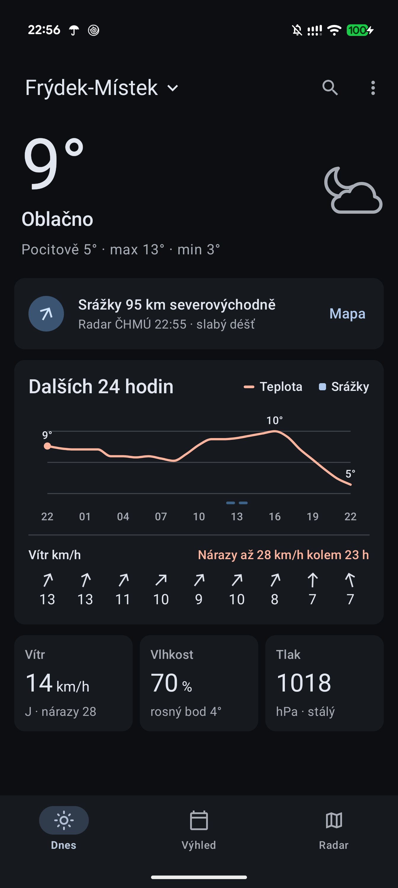
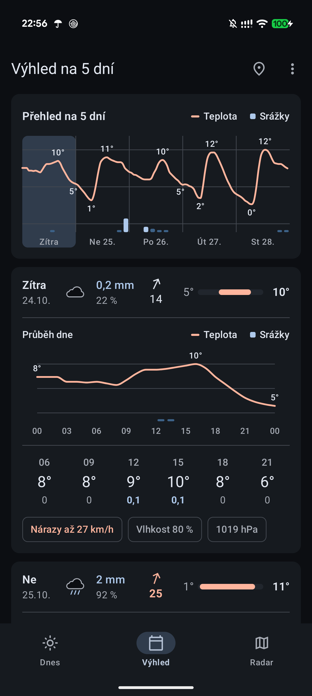
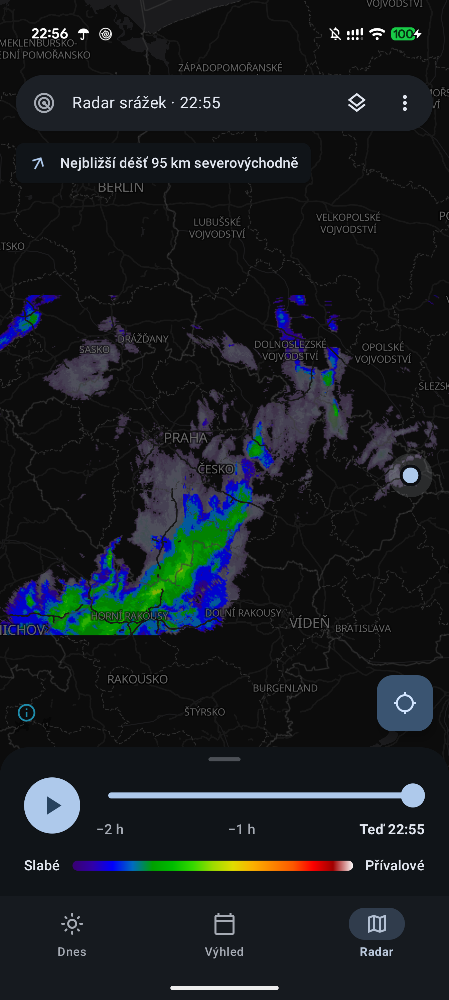

# Počasí

Nativní Android aplikace s předpovědí počasí pro Českou republiku z dat ČHMÚ. Aplikace je v češtině
a postavená na Material Design 3 (Material You, světlý i tmavý režim).

| Dnes | Výhled | Radar |
|---|---|---|
|  |  |  |

*Snímky z aplikace (tmavý režim, Google Pixel 10 Pro XL).*

## Funkce

- **Dnes** – aktuální teplota, pocitová teplota, max/min, nejbližší srážky z radaru, meteogram na 24 hodin
  (teplota, srážky, vítr) a karty Vítr / Vlhkost / Tlak.
- **Výhled** – 5 dní od zítřka s přehledovým grafem, rozbalitelnými dny s průběhem po 3 hodinách,
  srážkami, větrem a teplotním rozsahem.
- **Radar** – mapa s radarovými snímky ČHMÚ a animací posledních 2 hodin.
- **Místa** – poloha zařízení, vyhledávání míst (Česko a okolní státy), oblíbená místa s vlastním pořadím.
- **Widgety** – Počasí (kompaktní i s meteogramem) a Výhled na 5 dní.
- **Upozornění** – počasí v nastavené časy a dny včetně rady, zda vzít deštník.
- Vzhled Světlý / Tmavý / Podle systému.

## Technologie

- Kotlin, Jetpack Compose, Material 3
- Retrofit + kotlinx.serialization (OkHttp)
- MapLibre Android (mapa), Jetpack Glance + WorkManager (widgety), DataStore (nastavení a místa)
- Grafy a ikony kreslené vlastním kódem přes Compose `Canvas`
- Poloha přes systémový `LocationManager` (bez Google Play Services)
- minSdk 26, targetSdk 37

## Zdroje dat

- **Předpověď:** [Open-Meteo](https://open-meteo.com/en/docs/chmi-api), model ČHMÚ ALADIN
  (`chmi_aladin_seamless`, dál dopočítává ECMWF). Zdarma pro nekomerční použití.
- **Radar:** [otevřená data ČHMÚ](https://opendata.chmi.cz/meteorology/weather/radar/composite/) – kompozity
  radarové odrazivosti.
- **Mapa:** [OpenFreeMap](https://openfreemap.org/) (styly positron a dark), data © přispěvatelé
  [OpenStreetMap](https://www.openstreetmap.org/copyright).
- **Hledání míst:** Open-Meteo Geocoding API.

Žádná ze služeb nevyžaduje API klíč.

## Sestavení

Potřebuješ Android Studio (nebo JDK a Android SDK).

```bash
./gradlew assembleDebug
```

Výsledné APK je v `app/build/outputs/apk/debug/app-debug.apk`, do připojeného telefonu ho nainstaluje
`./gradlew installDebug`. Na Windows použij `gradlew.bat`.

Release build (`assembleRelease`) se podepisuje vlastním klíčem podle souboru `keystore.properties`
v kořeni projektu, který v repozitáři není. Bez něj vznikne nepodepsané APK.

## Autor

Ondřej Kisiala – připomínky a návrhy na o.kisiala@gmail.com

## Licence

[MIT](LICENSE)
